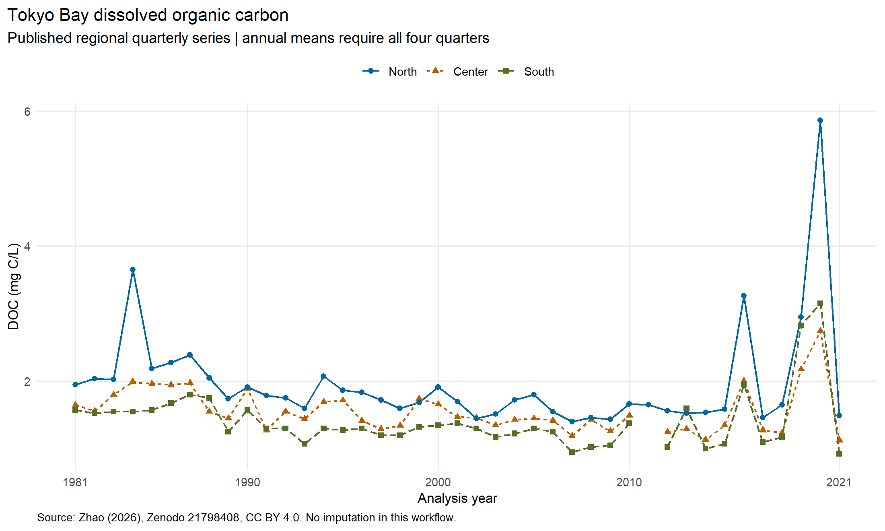

# Tokyo Bay Water Quality: A Reproducible R Analysis Workflow

A scientific data management and analysis project using the open dataset associated with a peer-reviewed study of Tokyo Bay, Japan, 1981-2021. The emphasis is on provenance, quality assurance, explicit analytical choices and reproducible delivery.

**Start here:** [generated analysis report](outputs/report.md) · [QA rules](docs/qc-rules.md) · [validation record](docs/validation.md) · [code provenance](docs/code-provenance.md)

## Project Overview

This project demonstrates an end-to-end R workflow for acquiring a fixed public data release, validating its schema and units, retaining record-level quality flags, analysing regional quarterly time series and generating reviewable tables, figures and documentation. It is designed to demonstrate skills relevant to scientific data and advice services, including the ICES Advice & Data Officer role.

The repository contains executable analysis code and real published data products. Synthetic values occur only in explicitly labelled automated test fixtures. This project is maintained independently and is not an ICES product or an endorsed assessment.

## Scientific Background

The wider doctoral research concerns DOC, POC, TOC and environmental variability in Tokyo Bay. The open release used here contains DOC, chlorophyll-a, pheophytin, total nitrogen, total phosphorus, water temperature, pH, dissolved oxygen, salinity and water clarity in three regions over 1981-2021.

The published study uses VAR/FEVD to examine DOC variance attribution. This repository provides a focused data QA and descriptive trend workflow; it does not claim to reproduce those multivariate models. Existing doctoral M0 carbon-process equations and parameter tables are not modified or calibrated.

## Data Sources and Provenance

- **Controlling source:** Zhao, Yuquan (2026), *Processed quarterly water-quality dataset for dissolved organic carbon variance attribution in Tokyo Bay, 1981-2021*, [Zenodo DOI 10.5281/zenodo.21798408](https://doi.org/10.5281/zenodo.21798408), licensed **CC BY 4.0**.
- The acquisition script retrieves `Tokyo_Bay_DOC_core_dataset_1981_2021.xlsx` and verifies the archive-supplied MD5. The source has 492 deposited regional records and 10 measured variables. Deposited row count is not equivalent to a unique, complete quarterly series.
- The workbook identifies Japan's Ministry of the Environment Water Environment Integrated Information Site as the original monitoring source. This repository retrieves the processed Zenodo release, not the original government files.
- The approved [six-station mapping](config/stations.csv) is preserved from the doctoral project. The open workbook already contains regional records; station-level aggregation cannot be reconstructed from this release.
- `Central` in the workbook is explicitly normalized to `Center`. Model quarters and actual sampling dates are kept separate. A Q4 record sampled the following February retains its original analysis year and quarter.
- TOC, POC, COD, DCOD, bottom observations and station-level measurements are not present in the open release. They are not fabricated or inferred.

See [data provenance and limitations](docs/data-provenance.md). The public input workbook is downloaded locally and ignored by Git. No restricted doctoral observations are bundled.

## Data Quality Control

All 4,920 regional-quarter-variable source records are preserved in [record_qc.csv](outputs/tables/record_qc.csv), with source worksheet row IDs, original values, units and separate flags for missing values, parse failures, unit mismatches, domain issues, duplicate keys and extreme values for review. No observations are interpolated.

**A real issue detected:** Center and South each have two 2011-Q2 rows and no 2011-Q1 row in the deposited workbook. Both members of each duplicate group are quarantined rather than arbitrarily selected, averaged or reassigned. Consequently 4,880 source measurements are eligible, and the completed 4,920-cell grid has 40 unavailable values. The source workbook is unchanged. Resolution requires review of the original campaign metadata or a corrected archival release.

Statistical outliers receive a review flag and remain in analysis. Missing or quarantined observations remain explicit gaps. Annual means require all four eligible quarters. [QC rules](docs/qc-rules.md) distinguish hard exclusions from review flags and document their rationale.

An optional [station-export QA adapter](scripts/audit_station_export.R) checks an approved local export against the six-station map and computes equal-station regional means, keeping surface and bottom separate. It is covered by synthetic unit tests; it has not been validated on a licensed, unit-verified raw station export. Its outputs are Git-ignored.

## Reproducible Workflow

```text
Pinned Zenodo workbook + configuration
                  |
                data.R     acquire, verify, standardize, retain QC flags
                  |
                model.R    annual summaries, seasonal trends, regional contrasts
                  |
                output.R   CSV tables and scientific PNG figures
                  |
                report.R   generated English Markdown report
```

`run_all.R` executes the four stages in order from the project root. The stage names are inspired by the [Transparent Assessment Framework](https://ices-tools-prod.r-universe.dev/TAF/doc/readme). **TAF/icesTAF has not been installed or validated for this project; full TAF compliance is not claimed.**

```text
R/                  acquisition, QA, statistics and plotting functions
config/             source checksum, variable/units contract, rules, station mapping
data-raw/           ignored downloaded workbook; acquisition documentation
data/processed/     complete regional quarterly analysis grid
outputs/tables/     retained flags, coverage, annual means, trends, residuals, contrasts
outputs/figures/    generated scientific figures
outputs/report.md  generated analysis report
docs/               methodology, provenance, validation and research audit
scripts/            dependency setup, validation and optional local station QA
tests/              source contracts, QA edge cases and statistical checks
renv.lock           actual package versions and R version used
```

## Statistical Analysis

For each region and variable, the workflow fits concentration against elapsed analysis years and quarterly indicators. This adapts the seasonal linear-regression approach inspected in the author's doctoral code. Approximate 95% intervals use Bartlett HAC covariance, four-quarter lag, finite-sample scaling and no prewhitening. Missing quarters retain their true time distances when estimating covariance; lag-8 sensitivity is also exported.

The 30 primary trend p-values receive Benjamini-Hochberg adjustment. Pointwise intervals are not simultaneous intervals. The minimum sample rule, QA bounds and coverage thresholds are explicitly configured. Paired regional contrasts compare matching analysis quarters and remain descriptive. Results summarize associations and full-period linear patterns; they do not establish ecological mechanisms or causal effects. See [methodology](docs/methodology.md).

## Outputs and Visualizations



Generated outputs include annual means with seasonal coverage counts, 30 seasonal trend summaries with lag-8 sensitivity, residual tables, paired regional contrasts and three figures. The [generated report](outputs/report.md) links tables and explains source limitations. The [data quality figure](outputs/figures/data_quality.png) shows eligible and deposited counts; the [trend figure](outputs/figures/seasonal_trends.png) displays estimates and uncertainty in each variable's original units.

## Installation and Requirements

Validated locally with **R 4.5.3 on Windows**. Install R separately; `renv` records but does not install R. Internet access is required for initial dependency restoration and data acquisition. The lockfile captures 45 packages, including transitive dependencies; the main analysis uses `readxl`, `ggplot2` and R's standard statistical tools. Tests use `testthat`.

Clone this existing repository using your GitHub credentials, enter its root directory, then run:

```sh
Rscript --vanilla scripts/setup.R
```

Setup bootstraps the pinned environment manager and restores `renv.lock`. The analytical entry point explicitly activates the project library even with `--vanilla`. Analyses do not install packages or change dependency versions. Package archives, operating-system libraries and fonts can affect future restoration or rendering; these are documented limitations, not guarantees of identical execution on every platform.

## How to Reproduce

```sh
Rscript --vanilla run_all.R
Rscript --vanilla tests/testthat.R
Rscript --vanilla scripts/validate_outputs.R
```

After the public input has been downloaded, use `Rscript --vanilla run_all.R --offline`. Missing inputs, changed checksums or incompatible schemas fail explicitly. No personal absolute paths are required.

For the separate-library restoration check used during development:

```sh
Rscript --vanilla scripts/verify_environment.R
```

This restores into `renv/restore-check/` and reruns the full analysis, tests and output checks. See the [validation record](docs/validation.md) for what actually passed and what remains unverified. Only synthetic test fixtures use randomness, with an explicit seed.

## Related Publication

Zhao, Y. and Tabeta, S. (2026). Dissolved organic carbon variance attribution shifts with prior environmental states and historical water-quality context along a eutrophication-marine exchange gradient. *Limnology and Oceanography*, **71**, e70503. [DOI: 10.1002/lno.70503](https://doi.org/10.1002/lno.70503).

## Author and Contact

**Yuquan Zhao** · The University of Tokyo · [GitHub: zhaoyuquan1218](https://github.com/zhaoyuquan1218) · [ORCID 0000-0002-5719-7356](https://orcid.org/0000-0002-5719-7356).

For project questions, contact the author through the GitHub profile or this repository's Issues. Code licensing has not yet been selected; no repository-wide software license is asserted. The upstream dataset's CC BY 4.0 attribution obligations apply to its derived data products. See [licensing](docs/licensing.md).
