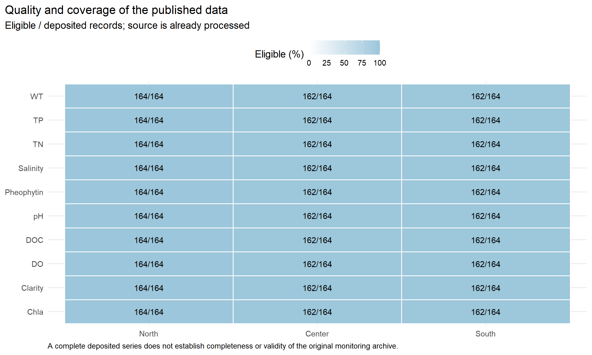
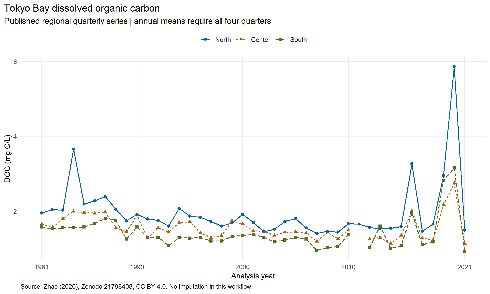
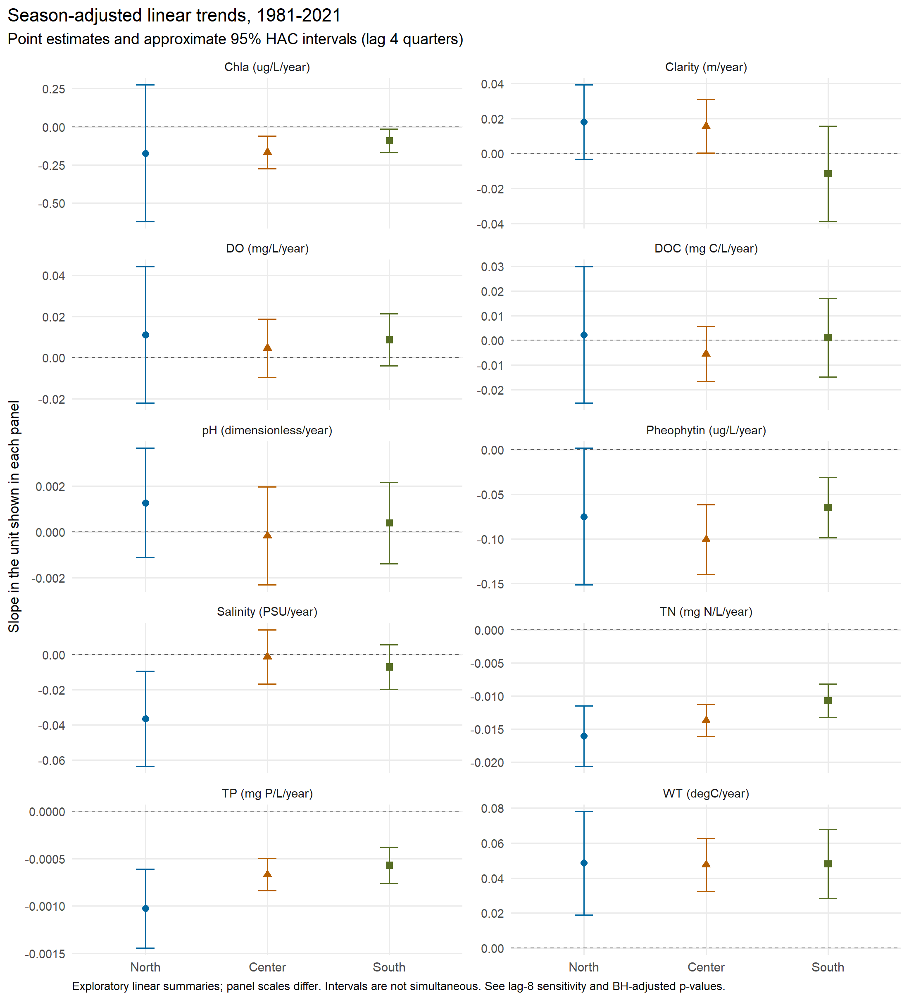

# Tokyo Bay water quality: reproducible analysis report

This report uses real, previously processed regional observations deposited by Zhao (2026).
It demonstrates data management and transparent statistical processing; it does not reproduce the publication's VAR/FEVD models.

## Data and QA

- Input: [Zenodo 21798408](https://doi.org/10.5281/zenodo.21798408), CC BY 4.0; verified MD5 `ef0874d94621c2fdb947bb3482a1d9d8`.
- 4920 regional-quarter-variable records retained; 4880 eligible; 49 review-only outliers.
- 4920 explicit quarterly grid cells; no missing values are filled by this workflow.
- Central is mapped explicitly to Center. Model period and actual sampling date remain separate, including Q4 observations sampled in the following year.
- Published inputs represent surface regional series. Original station records and bottom observations are not included.
- Source issue: Center and South each contain two 2011-Q2 records and no 2011-Q1 record. Both conflicting Q2 records are quarantined; no quarter is reassigned. This leaves four unavailable regional-quarter positions per variable in the completed grid.
- See [record-level flags](tables/record_qc.csv), [coverage summary](tables/qc_summary.csv) and [QC rules](../docs/qc-rules.md).

## DOC descriptive trends

Model: concentration ~ elapsed analysis years + quarter indicators, fitted independently for each region and variable.
Approximate 95% intervals use Bartlett HAC covariance with four-quarter lag, finite-sample scaling and no prewhitening.
P-values below use Benjamini-Hochberg adjustment across all 30 primary trend tests. Intervals are not simultaneous.

| Region | Quarterly n | Slope (mg C/L/year) | 95% HAC interval | BH-adjusted p |
|---|---:|---:|---|---:|
| Center | 162 | -0.00552 | [-0.01661, 0.00556] | 0.4698 |
| North | 164 | 0.00225 | [-0.02548, 0.02999] | 0.8932 |
| South | 162 | 0.00109 | [-0.01484, 0.01702] | 0.8932 |

Annual means require four eligible quarters. They summarize regional means and are not volume-weighted bay inventories.

## Statistical scope and limitations

- Linear slopes summarize the full interval; they do not identify changes in mechanism, nonlinear trajectories or causal drivers.
- Lag-8 HAC sensitivity, residual lag-1 correlation and R-squared are exported in [seasonal_trends.csv](tables/seasonal_trends.csv).
- [Regional contrasts](tables/regional_comparisons.csv) pair the same analysis quarters and are descriptive, with no causal interpretation.
- The deposited workbook has already been cleaned. This project cannot establish which original values were censored, excluded, transformed or filled before deposit.
- TOC, POC, COD and DCOD are absent from this release. No values are invented for them. No six-state M0 equations or parameters are changed.
- Methods and execution evidence: [methodology](../docs/methodology.md), [validation](../docs/validation.md), [code provenance](../docs/code-provenance.md).

## Related publication

Zhao, Y. and Tabeta, S. (2026). Dissolved organic carbon variance attribution shifts with prior environmental states and historical water-quality context along a eutrophication-marine exchange gradient. Limnology and Oceanography, 71, e70503. [doi:10.1002/lno.70503](https://doi.org/10.1002/lno.70503).
